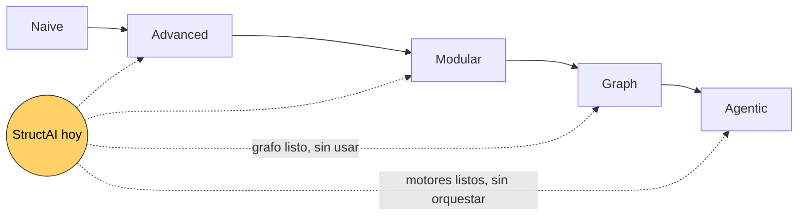
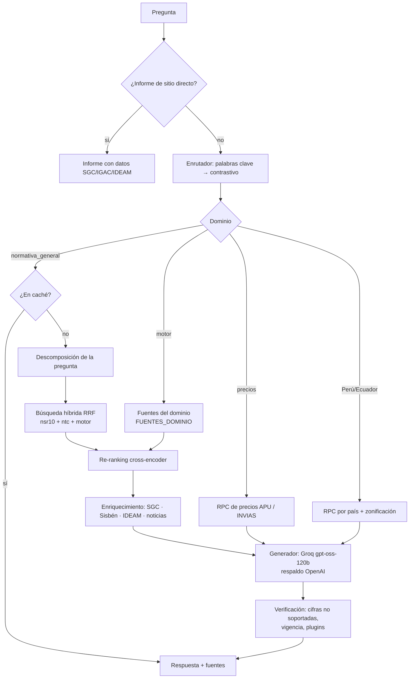
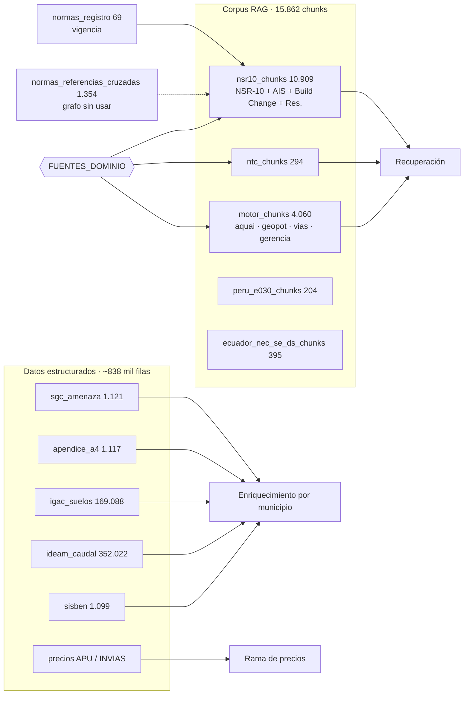

# StructAI en el panorama de los sistemas RAG: tipos, posición, mediciones y RAG geoespacial

Fecha: 2026-11-11. Documento de análisis, resultados y discusión. Las capacidades de StructAI se verificaron leyendo el código (`packages/construdata/rag_multi_norma.py`, `plugins_chat.py`, `apps/api/mcp_server.py`) y la base de datos en solo lectura.

**Marcas de evidencia:** **[V]** verificado hoy en la fuente · **[R]** medido o leído en este repositorio · **[M]** referencia conocida, citada de memoria: verificar antes de publicarla.

---

## 1. ¿Existen "8 tipos de RAG"?

**No hay una taxonomía científica oficial de ocho tipos.** Ese número viene de listas de divulgación. La literatura académica describe una **evolución por paradigmas** y un conjunto de **técnicas** que se combinan:

| Paradigma o técnica | Idea central | Referencia |
|---|---|---|
| **Naive RAG** | Recuperar los k fragmentos más parecidos y generar | Lewis et al. 2020 **[M]**; survey de Agentic RAG, arXiv:2501.09136 **[V]** |
| **Advanced RAG** | Búsqueda densa y léxica, re-ranking, consultas multi-salto | arXiv:2501.09136 **[V]**; Gao et al. 2023, arXiv:2312.10997 **[M]** |
| **Modular RAG** | Indexado, recuperación y generación como módulos configurables (enrutadores, fusión, memoria) | arXiv:2501.09136 **[V]** |
| **Graph RAG** | Recuperar sobre un grafo de entidades y relaciones; razonamiento multi-salto | arXiv:2501.09136 **[V]**; Edge et al. 2024 (GraphRAG), arXiv:2404.16130 **[M]** |
| **Agentic RAG** | Un agente decide cuándo y cómo recuperar, usa herramientas, itera y se corrige | arXiv:2501.09136 **[V]** |
| Corrective RAG (CRAG) | Un evaluador liviano califica lo recuperado; si es malo, corrige (otra búsqueda, descarta ruido) | Yan et al. 2024, arXiv:2401.15884 **[V]** |
| Self-RAG | El modelo reflexiona sobre lo recuperado y sobre su propia respuesta | arXiv:2501.09136 **[V]**; Asai et al. 2024, arXiv:2310.11511 **[M]** |
| Adaptive RAG | Elige la estrategia según la complejidad de la pregunta | Jeong et al. 2024 (NAACL), arXiv:2403.14403 **[M]** |
| HyDE | Genera una respuesta hipotética y la usa como consulta de búsqueda | Gao et al. 2022, arXiv:2212.10496 **[M]** |

Las listas populares de "8 tipos" suelen mezclar estas filas. El resumen útil: **los paradigmas son el eje de madurez y las técnicas son piezas que se suman.**

---

## 2. Posición de StructAI: matriz de capacidades (verificada en el código)

✓ implementado · ◐ parcial · ✗ ausente

| Capacidad | Paradigma | StructAI | Evidencia en el código |
|---|---|---|---|
| Búsqueda híbrida, densa + léxica, fusión RRF | Advanced | ✓ | RPC `search_knowledge` (vector + texto, RRF) |
| Re-ranking con cross-encoder | Advanced | ✓ | `cross-encoder/mmarco-mMiniLMv2-L12-H384-v1`, `PESO_RERANKER = 0.7` |
| Descomposición de preguntas | Advanced | ✓ | `_descomponer_pregunta` (issue #30) |
| Enrutador de dominio | Modular | ✓ | `_route_con_metodo`: palabras clave + contrastivo |
| Preguntas compuestas (dos dominios) | Modular | ✓ | `_ask_delegado_compuesto` (precio + norma) |
| Fuentes por dominio compartidas | Modular | ✓ | `FUENTES_DOMINIO` y contrato de integridad (#169, #170) |
| Datos estructurados en vivo por municipio | Modular, geoespacial | ✓ | SGC, Apéndice A-4, IGAC, IDEAM, Sisbén (`_bloque_contexto_sgc`) |
| Vigencia normativa en la recuperación | Confiable | ✓ | `advertencias_vigencia` desde `normas_registro` |
| Verificación posterior de cifras | Self/Corrective (parcial) | ◐ | `_detectar_posible_alucinacion_numerica`: avisa, pero no regenera |
| Abstención explícita | Confiable | ◐ | Reglas del prompt; callejones corregidos en 4e1e823 |
| Evaluador de calidad de recuperación **antes** de generar | Corrective (CRAG) | ✗ | El enrutador decide sin mirar la calidad de lo recuperado: es la causa del caso Sincelejo |
| Estrategia según la complejidad | Adaptive | ✗ | — |
| HyDE | Técnica | ✗ | — |
| Recuperación sobre grafo | Graph | ✗ con el grafo listo | `normas_referencias_cruzadas`: **1.354 aristas** fragmento → numeral, sin usar en la recuperación (issue #110) **[R]** |
| Agente que llama a los motores de cálculo como herramientas e itera | Agentic | ✗ | Los motores son endpoints aparte; el chat los explica, no los ejecuta. El servidor MCP expone solo `consultar` |
| Caché semántico y modo degradado | Ingeniería | ✓ | `rag_cache_respuestas`, `_respuesta_degradada` |

**Posición:** StructAI es un **RAG modular avanzado, con enrutamiento por dominio, inyección de datos geográficos oficiales y verificación posterior**. Está en el borde entre *Advanced* y *Modular*, con piezas de *Corrective*. **Todavía no es Graph RAG ni Agentic RAG**, aunque tiene la materia prima de ambos: un grafo de referencias ya construido y motores deterministas listos para usarse como herramientas.

---

## 3. Arquitectura actual: pipeline y bases de datos

### 3.1 Pipeline de una consulta

### 3.2 Datos y sus relaciones (conteos exactos **[R]**, inventario de #170)

---

## 4. Resultados medidos (lo que sabemos con números)

| Dimensión | Métrica | Valor | Fuente |
|---|---|---|---|
| Corpus | Chunks y normas | 15.862 en 109 normas; ninguna sin dominio | #170 **[R]** |
| Grafo | Aristas y resolución | 1.354: 292 exactas, 925 por prefijo, **137 sin destino (10,1 %)** | `normas_referencias_cruzadas` **[R]** |
| Enrutamiento (producción) | Aceptable / estricto, n = 58 | 70,7 % / 55,2 % | E1 **[R]** |
| Enrutamiento (candidato K6) | Aceptable / estricto | 86,2 % / 84,5 % (post hoc, sin significancia tras Holm) | E1c **[R]** |
| Separación de dominios | Coseno entre centroides | mediana 0,506; geopot–vías 0,782 | E1b **[R]** |
| Calidad de respuesta (RAGAS, 278 preguntas) | Faithfulness media por tipo | hecho 0,80 · coloquial 0,68 · síntesis 0,68 · adversaria 0,54 · comparativa 0,53 | Auditoría #109 **[R]** |
| Medición con faltantes | Faithfulness / context precision faltantes | 32,4 % / 51,4 %, no al azar | #109 **[R]** |
| Generador local (CI) | Piloto, 38 casos | qwen2.5:7b 38/38, sin alucinación numérica | #172 **[R]** |
| Latencia local | p50 por caso | 132–151 s en CPU | #172 **[R]** |
| Latencia y costo en producción | — | **sin medir** (#84) | — |

### Medidas que relacionan componentes (para análisis estadístico)

- **Enrutamiento → respuesta:** en el E1, 6 de 58 preguntas respondibles caían en un "callejón" (abstención segura). El fallo del enrutador se propaga directamente a la respuesta. Una regresión logística de acierto final sobre acierto de enrutamiento, por estrato, cuantificaría ese efecto.
- **Tipo de pregunta → calidad:** la faithfulness cae de 0,80 (hechos) a 0,53–0,54 (comparativas y adversarias). El efecto del tipo se estima con un modelo mixto, con el título de la norma como efecto aleatorio.
- **Calidad del corpus → calidad de respuesta:** el 10,1 % de referencias sin destino en el grafo es una medida de huecos de ingesta. Se puede cruzar con las preguntas que fallan por título.

---

## 5. RAG geoespacial: ¿existe? ¿Cómo se mide?

**Sí existe, y es un campo activo (2025–2026):**

| Trabajo | Qué hace | Cómo lo miden |
|---|---|---|
| **Spatial-RAG** (Yu et al., arXiv:2502.18470, v5 jun-2025) **[V]** | Recuperador espacial híbrido: **filtro espacial disperso + coincidencia semántica densa** sobre bases espaciales estructuradas; selección Pareto entre relevancia espacial y semántica | Datasets de turismo y mapas (TourismQA NYC y Miami, MapQA); Precision@k, Recall@k, F1@k, NDCG@k; métricas espaciales (*Delivery Rate*, *Spatial Sparse/Dense Pass Rate*, *Semantic Pass Rate*) — según fuente secundaria, a verificar en el PDF |
| **GeoRAG** con grafo espacio-temporal urbano (Springer) **[V, secundaria]** | Grafo de conocimiento urbano para razonamiento espacial | Benchmark CityGPT (Pekín, Londres, Nueva York): exactitud |
| **GeoRAG** para preguntas geográficas (arXiv:2504.01458) **[V, secundaria]** | QA geográfico | Exactitud, F1, consistencia factual, tasa de alucinación |
| **GeoGPT-RAG** (arXiv:2509.09686) **[V, secundaria]** | Recuperación en geociencias | Benchmark GeoRAG-QA |
| **Mil-SCORE** (arXiv:2601.21826) **[V, secundaria]** | Benchmark de razonamiento y planificación geoespacial de contexto largo | Describe la tendencia: los benchmarks nuevos (GeoAnalystBench, GeoBenchX) evalúan a los LLM **como agentes** que operan herramientas GIS |

### StructAI frente a ese estado del arte

- **Lo que ya hace:** un **filtro espacial disperso por unidad administrativa**. Detecta el municipio en el texto, desambigua homónimos (`_desambiguar`) y une datos oficiales por código municipal. Es la mitad "dispersa" de Spatial-RAG, aplicada a datos oficiales colombianos.
- **Lo que no hace:** coordenadas o polígonos, consultas por distancia o radio ("pozos a menos de 5 km"), cruces espaciales entre capas (suelo IGAC × amenaza SGC sobre un predio) y razonamiento espacial en la respuesta.
- **Oportunidad propia:** casi todos los benchmarks geoespaciales son de ciudades de EE. UU., Europa o China y de turismo. **No conocemos ninguno de ingeniería civil ni de Colombia [P].** Un benchmark geoespacial de ingeniería colombiana, con verdad tomada de tablas oficiales, sería una contribución publicable.

### Cómo mediría StructAI su capacidad geoespacial (propuesta)

| Métrica | Qué mide | Verdad de referencia |
|---|---|---|
| Exactitud de resolución del lugar | ¿Identifica el municipio correcto, incluidos homónimos y escritura coloquial? | Códigos DANE |
| Exactitud del dato | ¿Aa, Av, zona, suelo y caudal citados coinciden con la tabla oficial? | `sgc_amenaza`, A-4, IGAC, IDEAM |
| Abstención espacial | ¿Se abstiene si el lugar no tiene dato (p. ej. sin microzonificación)? | Cobertura de cada tabla |
| *Spatial pass rate* (al estilo Spatial-RAG) | ¿La respuesta usa el dato del lugar pedido y no de uno vecino? | Sabotaje: cambiar el municipio por uno vecino (#169) |
| Robustez contrafactual | ¿Detecta un Aa alterado en un documento? | Golden de sabotaje (#169, #174) |

---

## 6. Cómo se mide un RAG científicamente (y qué cubre StructAI)

| Marco | Qué mide | ¿StructAI lo cubre? |
|---|---|---|
| **RAGAS** (Es et al. 2024, arXiv:2309.15217 **[M]**) | Faithfulness, answer relevancy, context precision y context recall, con juez LLM | ✓ corridas 2026-08/09, con juez sin calibrar (#175) |
| **RGB** (Chen et al. 2024, arXiv:2309.01431 **[M]**) | Cuatro capacidades: robustez al ruido, rechazo negativo, integración de información, robustez contrafactual | ◐ ruido: distractores RAFT y E1 · rechazo: abstención y adversarias · integración: preguntas compuestas · contrafactual: **golden de sabotaje (#169)** |
| **ARES** (Saad-Falcon et al. 2024, arXiv:2311.09476 **[M]**) | Jueces entrenados más intervalos de predicción con pocas anotaciones humanas | ✗ (relacionado con #175) |
| Evaluación por componente | Enrutamiento, recall@k de la recuperación y generación por separado | ✓ E1/E1c, harness #172; recall@k en E2 pendiente |
| Estadística | IC bootstrap, McNemar pareado, Holm, bootstrap por clúster | ✓ `packages/eval-stats` |

---

## 7. Discusión: qué tipo de RAG le conviene a StructAI

1. **Corrective antes que Agentic.** El fallo más caro medido (enrutamiento → callejón) se resuelve con un **evaluador de la calidad de lo recuperado antes de generar** (estilo CRAG): si la recuperación del dominio elegido es pobre, reintentar con el general en vez de abstenerse. Es barato y ataca un fallo real.
2. **Graph RAG sobre lo que ya existe.** Las 1.354 aristas permiten seguir referencias ("ver C.21.6") en preguntas multi-salto, justo donde la faithfulness es más baja (comparativas 0,53). Además, las 137 referencias sin destino son una lista de huecos de ingesta para corregir.
3. **Agentic con motores deterministas.** La regla del proyecto ("el LLM no calcula") encaja con un agente que **llama** a los motores (vivienda, concreto, redes) como herramientas y explica su salida. El MCP ya existe y hoy expone solo `consultar`.
4. **Geoespacial completo.** Pasar del filtro por municipio a coordenadas y radios (pozos, #181) y a cruces de capas para un predio. Medirlo con el benchmark de §5.
5. **No adoptar por moda.** HyDE y Adaptive RAG no responden a ningún fallo medido hoy. Cada paso nuevo se adopta con el mismo protocolo: medición preregistrada, IC y sin regresión.

## Referencias

- Singh, A. et al. (2025). Agentic Retrieval-Augmented Generation: A Survey on Agentic RAG. arXiv:2501.09136. https://arxiv.org/abs/2501.09136
- Yan, S.-Q., Gu, J.-C., Zhu, Y. y Ling, Z.-H. (2024). Corrective Retrieval Augmented Generation. arXiv:2401.15884. https://arxiv.org/abs/2401.15884
- Yu, D. et al. (2025). Spatial-RAG: Spatial Retrieval Augmented Generation for Real-World Geospatial Reasoning Questions. arXiv:2502.18470. https://arxiv.org/abs/2502.18470
- GeoRAG (QA geográfico), arXiv:2504.01458. https://arxiv.org/html/2504.01458v1
- GeoRAG (grafo urbano espacio-temporal), Springer. https://link.springer.com/chapter/10.1007/978-981-95-4788-3_12
- GeoGPT-RAG Technical Report, arXiv:2509.09686. https://arxiv.org/pdf/2509.09686
- Mil-SCORE, arXiv:2601.21826. https://arxiv.org/pdf/2601.21826
- **[M], verificar antes de publicar:** Lewis et al. 2020 (arXiv:2005.11401); Gao et al. 2023 (arXiv:2312.10997); Edge et al. 2024 (arXiv:2404.16130); Asai et al. 2024 (arXiv:2310.11511); Jeong et al. 2024 (arXiv:2403.14403); Gao et al. 2022 (arXiv:2212.10496); Es et al. 2024 (arXiv:2309.15217); Chen et al. 2024 (arXiv:2309.01431); Saad-Falcon et al. 2024 (arXiv:2311.09476).
