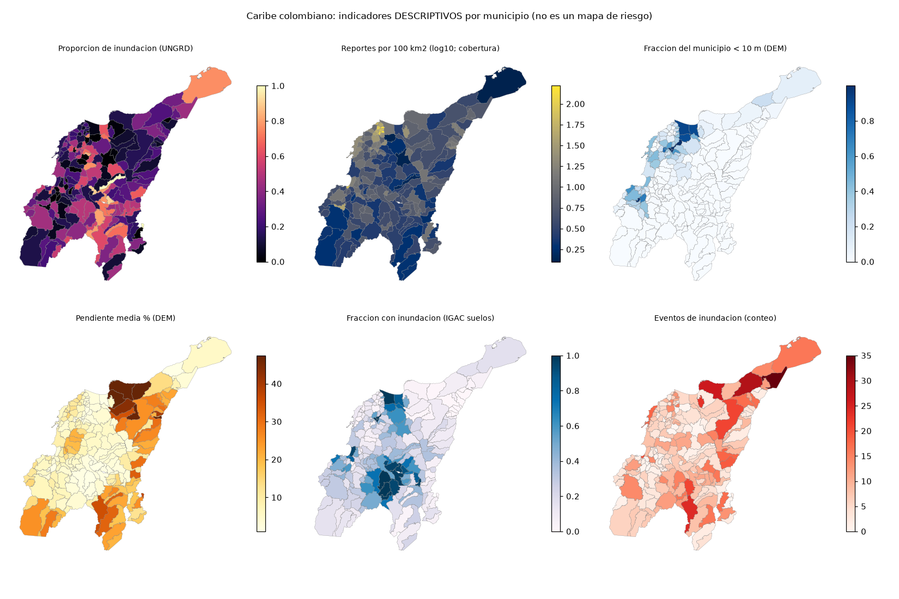

# Auditoria de datos del Caribe (borrador reproducible)
Generado: 2026-11-06. Semilla fija. Script: `scripts/satelite/auditar_datos_caribe.py`.

## 1. Inventario y faltantes
| fuente | n | faltantes |
|---|---|---|
| DEM (poligonos IGAC) | 195 | 0 sin estadistica |
| Poligonos con geometria | 195 | 0 DEM sin poligono |
| Eventos UNGRD (195 municipios) | 5670 | — |
| Municipios con clasificacion de inundacion IGAC | 195 | 0 faltan |
| Municipios con muestra Sisben | 195 | 0 faltan |
| Municipios con poblacion DANE 2020 | 195 | 0 faltan |

## 2. Duplicados
- Codigos de municipio repetidos en el DEM: **0**.
- Eventos UNGRD con id repetido: **0**.
- Eventos UNGRD identicos en (municipio, fecha, evento, personas, familias, viviendas, hectareas): **975** filas extra de 5670 (17.2 %). Pueden ser duplicados reales o eventos distintos con los mismos numeros (p. ej. varios sin dato); no se eliminan sin criterio.

## 3. Coherencia de fechas (UNGRD)
- Fechas nulas: 0. Fuera de [2019-01-01, 2026-11-06]: 0.
- Eventos con fecha posterior a su propia carga en la base: 0.
| año | eventos | inundaciones | % inundacion |
|---|---|---|---|
| 2019 | 570 | 80 | 14.0 |
| 2020 | 574 | 166 | 28.9 |
| 2021 | 439 | 151 | 34.4 |
| 2022 | 1221 | 663 | 54.3 |
| 2023 | 885 | 140 | 15.8 |
| 2024 | 1981 | 160 | 8.1 |

Variacion entre años: CV = 0.61; el mayor año tiene 2.7x la mediana (2022 es un año de lluvias extremas: la serie NO es estacionaria).

Distribucion mensual de eventos: 01:976, 02:970, 03:831, 04:416, 05:245, 06:323, 07:257, 08:312, 09:325, 10:400, 11:449, 12:166

## 4. Estadistica descriptiva (media y mediana con IC95 % bootstrap)
### 4.1 Global
| variable | n | media [IC95%] | mediana [IC95%] | DE | p5 | p25 | p75 | p95 | asimetria | min / max |
|---|---|---|---|---|---|---|---|---|---|---|
| elevacion media (m) | 195 | 200 [161, 252] | 70.8 [57.2, 84.2] | 322 | 8.89 | 31.5 | 205 | 969 | 2.86 | 2.48 / 1.96e+03 |
| pendiente media (%) | 195 | 11.2 [9.75, 12.8] | 6.71 [5.49, 8] | 10.9 | 1.42 | 3.45 | 16.5 | 33.4 | 1.55 | 1.03 / 47.4 |
| pendiente p90 (%) | 195 | 25.3 [22.3, 28.7] | 15.2 [13, 18.7] | 22.7 | 3.34 | 7.31 | 41.7 | 68.8 | 0.99 | 2.33 / 86.9 |
| rango de elevacion (m) | 195 | 837 [684, 1.03e+03] | 240 [198, 305] | 1.23e+03 | 27.6 | 122 | 1.03e+03 | 3.6e+03 | 2.06 | 14 / 5.69e+03 |
| fraccion < 10 m | 195 | 0.126 [0.0961, 0.163] | 0 [0, 0.00138] | 0.237 | 0 | 0 | 0.163 | 0.711 | 2.27 | 0 / 0.999 |
| fraccion pendiente > 15 % | 195 | 0.215 [0.183, 0.252] | 0.102 [0.0701, 0.158] | 0.249 | 0.000331 | 0.00946 | 0.392 | 0.717 | 1.09 | 0 / 0.907 |
| IGAC fraccion con inundacion | 195 | 0.301 [0.264, 0.342] | 0.212 [0.165, 0.257] | 0.281 | 0.0114 | 0.084 | 0.421 | 0.961 | 1.16 | 0 / 1 |
| area (km2) | 195 | 681 [584, 836] | 426 [364, 522] | 864 | 82.3 | 206 | 852 | 1.84e+03 | 4.41 | 42.6 / 7.92e+03 |
| eventos totales | 195 | 29.1 [25.4, 33.8] | 20 [15, 23] | 29.4 | 4 | 10 | 36.5 | 94.2 | 2.28 | 1 / 195 |
| eventos de inundacion | 195 | 6.97 [6.17, 7.87] | 6 [5, 6] | 5.99 | 0 | 3 | 10 | 18 | 1.47 | 0 / 35 |
| proporcion de inundacion | 195 | 0.315 [0.282, 0.35] | 0.25 [0.217, 0.305] | 0.241 | 0 | 0.125 | 0.5 | 0.764 | 0.68 | 0 / 1 |
| reportes / 100 km2 | 195 | 10 [7.87, 13.8] | 4.27 [3.43, 5.12] | 19.8 | 0.949 | 1.97 | 9.1 | 37.9 | 4.89 | 0.265 / 164 |
| Sisben viviendas (muestra) | 195 | 1.77e+03 [1.7e+03, 1.84e+03] | 1.74e+03 [1.65e+03, 1.84e+03] | 512 | 982 | 1.41e+03 | 2.06e+03 | 2.68e+03 | 0.41 | 669 / 3.36e+03 |
| poblacion DANE 2020 | 195 | 5.82e+04 [4.36e+04, 8.56e+04] | 2.41e+04 [2.14e+04, 2.82e+04] | 1.38e+05 | 8.61e+03 | 1.56e+04 | 4.34e+04 | 1.53e+05 | 6.06 | 3.79e+03 / 1.26e+06 |
| % poblacion en cabecera | 195 | 0.557 [0.523, 0.591] | 0.558 [0.508, 0.616] | 0.239 | 0.171 | 0.367 | 0.756 | 0.932 | -0.04 | 0.0527 / 0.999 |
| reportes / 100 mil hab. | 195 | 90.7 [81.4, 102] | 70.1 [61.9, 78.6] | 73.6 | 14.3 | 40.6 | 122 | 230 | 1.84 | 3.58 / 422 |
| densidad (hab/km2) | 195 | 215 [121, 454] | 57 [51.3, 69.8] | 986 | 18.9 | 32.8 | 118 | 529 | 9.43 | 7.89 / 1.1e+04 |

### 4.2 Por departamento (variables clave)
**fraccion < 10 m**
| variable | n | media [IC95%] | mediana [IC95%] | DE | p5 | p25 | p75 | p95 | asimetria | min / max |
|---|---|---|---|---|---|---|---|---|---|---|
| Atlántico | 23 | 0.311 [0.206, 0.463] | 0.209 [0.132, 0.39] | 0.315 | 0 | 0.0737 | 0.397 | 0.997 | 1.19 | 0 / 0.999 |
| Magdalena | 30 | 0.216 [0.123, 0.356] | 0.0458 [0, 0.18] | 0.321 | 0 | 0 | 0.284 | 0.911 | 1.45 | 0 / 0.996 |
| Bolívar | 46 | 0.0981 [0.0544, 0.17] | 0 [0, 0.000711] | 0.193 | 0 | 0 | 0.112 | 0.434 | 2.14 | 0 / 0.796 |
| Córdoba | 30 | 0.161 [0.0893, 0.276] | 0.00844 [0, 0.182] | 0.251 | 0 | 0 | 0.252 | 0.672 | 1.77 | 0 / 0.982 |
| Sucre | 26 | 0.0434 [0.0112, 0.113] | 0 [0, 0] | 0.118 | 0 | 0 | 0 | 0.339 | 2.70 | 0 / 0.443 |
| Cesar | 25 | 0.000707 [0.000203, 0.002] | 0 [0, 0] | 0.00194 | 0 | 0 | 0 | 0.00399 | 3.05 | 0 / 0.00848 |
| La Guajira | 15 | 0.0326 [0.013, 0.0823] | 0.0033 [0, 0.0373] | 0.0596 | 0 | 0 | 0.0422 | 0.133 | 2.38 | 0 / 0.223 |

**pendiente media (%)**
| variable | n | media [IC95%] | mediana [IC95%] | DE | p5 | p25 | p75 | p95 | asimetria | min / max |
|---|---|---|---|---|---|---|---|---|---|---|
| Atlántico | 23 | 5.75 [4.22, 7.56] | 4.19 [2.78, 9.19] | 4.17 | 1.22 | 2.24 | 9.66 | 13.2 | 0.60 | 1.13 / 13.4 |
| Magdalena | 30 | 9.1 [5.17, 15.7] | 4.2 [2.97, 4.88] | 13.8 | 1.95 | 2.79 | 5.28 | 45.6 | 2.19 | 1.04 / 47.4 |
| Bolívar | 46 | 11.1 [8.69, 14] | 8.02 [5.86, 10.9] | 9.35 | 1.45 | 3.61 | 18.1 | 30.6 | 0.95 | 1.25 / 35.3 |
| Córdoba | 30 | 9.25 [7.34, 12.2] | 6.9 [6.08, 9.32] | 6.69 | 2.09 | 5.1 | 12 | 23.2 | 1.37 | 1.31 / 28.4 |
| Sucre | 26 | 6.58 [4.86, 9.26] | 4.55 [3.53, 6.73] | 5.6 | 1.57 | 2.85 | 8.11 | 18.1 | 1.56 | 1.03 / 22.9 |
| Cesar | 25 | 20.3 [15.6, 25.5] | 18.8 [11.3, 26.3] | 12.9 | 2.96 | 10.8 | 28.1 | 44.8 | 0.42 | 2.47 / 47.3 |
| La Guajira | 15 | 20.3 [14.6, 27.3] | 20.8 [13.8, 28] | 13 | 2.72 | 10.9 | 26.1 | 42 | 0.38 | 1.2 / 47.4 |

**eventos de inundacion**
| variable | n | media [IC95%] | mediana [IC95%] | DE | p5 | p25 | p75 | p95 | asimetria | min / max |
|---|---|---|---|---|---|---|---|---|---|---|
| Atlántico | 23 | 6.96 [5.35, 8.91] | 6 [4, 9] | 4.49 | 1.1 | 3.5 | 10 | 14 | 0.42 | 0 / 15 |
| Magdalena | 30 | 6.27 [4.47, 9.13] | 4.5 [3, 6.5] | 6.3 | 0 | 2 | 8.5 | 19.8 | 1.69 | 0 / 26 |
| Bolívar | 46 | 7.54 [6.26, 9.15] | 7 [6, 8] | 4.94 | 0.5 | 5 | 9.75 | 17.5 | 1.27 | 0 / 24 |
| Córdoba | 30 | 4.4 [3.23, 5.9] | 3 [3, 6] | 3.69 | 0 | 1.25 | 6 | 12 | 1.01 | 0 / 14 |
| Sucre | 26 | 6.27 [4.42, 8.69] | 5.5 [2, 8] | 5.63 | 0 | 2 | 8.75 | 15.8 | 0.82 | 0 / 20 |
| Cesar | 25 | 7.88 [5.64, 10.7] | 5 [3, 11] | 6.55 | 1 | 3 | 13 | 18.8 | 0.62 | 0 / 21 |
| La Guajira | 15 | 11.5 [7.2, 17.5] | 11 [2, 16] | 10.3 | 1.4 | 2.5 | 16.5 | 30.8 | 0.91 | 0 / 35 |

**proporcion de inundacion**
| variable | n | media [IC95%] | mediana [IC95%] | DE | p5 | p25 | p75 | p95 | asimetria | min / max |
|---|---|---|---|---|---|---|---|---|---|---|
| Atlántico | 23 | 0.252 [0.18, 0.348] | 0.188 [0.116, 0.265] | 0.21 | 0.0197 | 0.114 | 0.363 | 0.613 | 0.96 | 0 / 0.75 |
| Magdalena | 30 | 0.344 [0.242, 0.46] | 0.232 [0.122, 0.548] | 0.307 | 0 | 0.0846 | 0.608 | 0.818 | 0.51 | 0 / 1 |
| Bolívar | 46 | 0.414 [0.338, 0.489] | 0.412 [0.245, 0.545] | 0.263 | 0.0129 | 0.169 | 0.6 | 0.806 | 0.12 | 0 / 0.909 |
| Córdoba | 30 | 0.27 [0.204, 0.342] | 0.26 [0.128, 0.382] | 0.197 | 0 | 0.103 | 0.421 | 0.575 | 0.23 | 0 / 0.667 |
| Sucre | 26 | 0.273 [0.202, 0.349] | 0.225 [0.16, 0.4] | 0.196 | 0 | 0.136 | 0.46 | 0.558 | 0.18 | 0 / 0.625 |
| Cesar | 25 | 0.281 [0.213, 0.394] | 0.243 [0.158, 0.267] | 0.222 | 0.0753 | 0.151 | 0.305 | 0.638 | 1.61 | 0 / 1 |
| La Guajira | 15 | 0.272 [0.195, 0.386] | 0.267 [0.125, 0.36] | 0.186 | 0.0467 | 0.122 | 0.347 | 0.535 | 0.97 | 0 / 0.762 |

### 4.3 Por clase dominante de textura del suelo (IGAC; grupos con n >= 5)
| variable | n | media [IC95%] | mediana [IC95%] | DE | p5 | p25 | p75 | p95 | asimetria | min / max |
|---|---|---|---|---|---|---|---|---|---|---|
| Franco limosa (n=138) | 138 | 0.333 [0.293, 0.375] | 0.268 [0.22, 0.388] | 0.249 | 0 | 0.13 | 0.512 | 0.781 | 0.51 | 0 / 1 |
| Franco arenosa (n=27) | 27 | 0.243 [0.186, 0.311] | 0.2 [0.133, 0.293] | 0.167 | 0.0419 | 0.116 | 0.314 | 0.56 | 0.83 | 0 / 0.636 |
| Arcillosa (n=8) | 8 | 0.401 [0.206, 0.597] | 0.429 [0.118, 0.692] | 0.301 | 0.0306 | 0.171 | 0.635 | 0.738 | -0.10 | 0.0233 / 0.762 |
| Franca (n=8) | 8 | 0.191 [0.108, 0.316] | 0.164 [0.0667, 0.267] | 0.157 | 0.0233 | 0.0917 | 0.266 | 0.418 | 0.81 | 0 / 0.5 |

(Variable: proporcion de inundacion. Descriptivo; no implica causalidad.)

## 5. Valores atipicos (descriptivo, no se eliminan)
Reglas: cercas de Tukey (1.5 y 3 IQR) y z robusto con MAD > 3.5 (convencion de Iglewicz y Hoaglin). Son convenciones, no verdades.

| variable | Tukey 1.5 | Tukey 3 | z robusto>3.5 | tres valores mas altos |
|---|---|---|---|---|
| pendiente media (%) | 8 | 0 | 17 | Ciénaga (47.4), Dibulla (47.4), Manaure Balcón Del Cesar (47.3) |
| fraccion < 10 m | 20 | 11 | 0 | Santa Lucía (0.999), Campo De La Cruz (0.999), Salamina (0.996) |
| area (km2) | 10 | 5 | 13 | Uribia (7.92e+03), Tierralta (4.96e+03), Valledupar (4.21e+03) |
| eventos totales | 15 | 4 | 16 | Santa Marta (195), Valledupar (139), Cartagena De Indias (121) |
| eventos de inundacion | 7 | 1 | 5 | Maicao (35), Riohacha (29), Santa Marta (26) |
| proporcion de inundacion | 0 | 0 | 0 | Pijiño Del Carmen (1), González (1), Margarita (0.909) |

### 4.4 Capacidad de reportar: ¿se explica por el tamaño poblacional?
rho de Spearman entre poblacion DANE y total de reportes UNGRD: **0.59** [IC95% 0.49, 0.68] (n=195). Si es alto, los conteos brutos miden sobre todo tamaño poblacional, no amenaza.

## 6. Colinealidad entre predictores candidatos
| Spearman | fraccion < 10 m | elevacion media | pendiente media | pendiente p90 | rango de elevacion | fraccion pend > 15 % | IGAC inundable |
|---|---|---|---|---|---|---|---|
| fraccion < 10 m | 1.00 | -0.61 | -0.40 | -0.37 | -0.37 | -0.34 | 0.18 |
| elevacion media | -0.61 | 1.00 | 0.89 | 0.87 | 0.85 | 0.83 | -0.68 |
| pendiente media | -0.40 | 0.89 | 1.00 | 0.99 | 0.90 | 0.97 | -0.70 |
| pendiente p90 | -0.37 | 0.87 | 0.99 | 1.00 | 0.91 | 0.96 | -0.67 |
| rango de elevacion | -0.37 | 0.85 | 0.90 | 0.91 | 1.00 | 0.90 | -0.64 |
| fraccion pend > 15 % | -0.34 | 0.83 | 0.97 | 0.96 | 0.90 | 1.00 | -0.65 |
| IGAC inundable | 0.18 | -0.68 | -0.70 | -0.67 | -0.64 | -0.65 | 1.00 |

| predictor | VIF (sobre rangos) |
|---|---|
| fraccion < 10 m | 2.3 |
| elevacion media | 12.6 |
| pendiente media | 85.9 |
| pendiente p90 | 47.7 |
| rango de elevacion | 8.6 |
| fraccion pend > 15 % | 25.4 |
| IGAC inundable | 2.4 |

n = 195 municipios completos. Umbrales habituales (|rho| > 0.8; VIF > 5 o 10) son **reglas empiricas** que se usan con cautela. Los predictores de relieve miden casi lo mismo: no se pueden poner juntos en un modelo ni interpretar sus coeficientes por separado.

## 7. Autocorrelacion espacial (I de Moran, 8 vecinos mas cercanos, permutacion)
| variable | I de Moran | p (permutacion) |
|---|---|---|
| proporcion de inundacion | 0.21 | 0.001 |
| fraccion < 10 m | 0.59 | 0.001 |
| pendiente media | 0.53 | 0.001 |
| eventos totales | 0.19 | 0.001 |

Un I de Moran alto significa que municipios vecinos se parecen: las observaciones NO son independientes y los p-valores ingenuos son demasiado optimistas. Por eso el analisis confirmatorio usa remuestreo por departamentos y replicacion por bloque.

## 8. Potencia estadistica (simulacion; piso optimista)
| situacion | n | |rho| minimo detectable (potencia 80 %, alfa 5 %) |
|---|---|---|
| Atlantico, piloto anterior | 23 | 0.60 |
| Caribe, municipios con >= 10 reportes | 156 | 0.25 |
| Bloques (departamentos) como unidad | 7 | nan |

Interpretacion: un resultado nulo con n = 23 solo descarta asociaciones fuertes; con n ~ 190 se detectan correlaciones moderadas; con 7 bloques casi nada. Con dependencia espacial la potencia real es menor que estos pisos.

## 9. Zonas sin cobertura de reporte
| departamento | municipios | con < 10 reportes UNGRD | % |
|---|---|---|---|
| Atlántico | 23 | 0 | 0 |
| Magdalena | 30 | 9 | 30 |
| Bolívar | 46 | 6 | 13 |
| Córdoba | 30 | 11 | 37 |
| Sucre | 26 | 8 | 31 |
| Cesar | 25 | 5 | 20 |
| La Guajira | 15 | 0 | 0 |

Estos municipios no se pueden distinguir entre 'sin inundaciones' y 'sin capacidad de reportar'. Quedan fuera del analisis principal.

Resolucion efectiva del DEM por municipio (m): {31: 179, 32: 2, 33: 1, 35: 2, 36: 3, 37: 1, 39: 1, 40: 2, 43: 1, 48: 1, 50: 1, 61: 1}. Los municipios grandes se leyeron decimados.

## 10. Mapas

**Por que no hay un mapa de 'riesgo':** riesgo = amenaza x exposicion x vulnerabilidad. Hoy no tenemos un modelo de amenaza validado ni la poblacion expuesta; un mapa compuesto daria apariencia de precision que los datos no respaldan. Se muestran los componentes por separado y la cobertura de reporte (que condiciona la lectura de todos).
